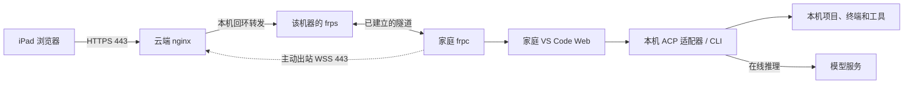

# RemoteCode

通过 iPad 浏览器访问家庭电脑上的 VS Code Web，在家庭电脑上编辑项目、运行终端和使用 Codex / Claude。云服务器提供 HTTPS 入口和隧道转发，支持公网 IPv4、无域名访问，以及多台家庭主机。

## 信息流



- 家庭 frpc 主动连接云端，浏览器请求沿隧道到达家庭 IDE，响应原路返回；家庭网络无需开放公网入站端口。
- 云端只发布 TCP 443；每台机器使用独立隧道、token 和浏览器密码，IDE 与内部转发端口只监听回环地址。
- 项目与工具在家庭电脑运行；Codex / Claude 默认向在线模型发送相关上下文。云端会终止 TLS 并代理流量，适用于受信任的个人多机使用。
- 可选 [QQ Bot](docs/qq-bot.md) 由家庭电脑直接连接 QQ，处理 ACP 审批与已授权截图发送，只给引用、不在本 README 展开。

## 前置要求与需要你输入的信息

| 位置 | 前置要求 | 你需要输入/准备 |
|---|---|---|
| 云服务器 | Ubuntu 22.04+ / Debian 12+ / RHEL 家族（Rocky、Alma、CentOS Stream 9、Amazon Linux 2023、openEuler 22.03+ 等），x64 或 ARM64；TCP 443 可用 | 公网 IPv4、机器标识（如 `pc1`）、长期 state 目录（建议 `/opt/remotecode-state`） |
| 家庭电脑 | Windows 10/11、macOS 或 Linux，普通开发账号；项目目录与运行目录分开 | 工作区目录（如 `$HOME/Projects`）；按需先装 Codex CLI / Claude CLI（前置，检测到即用，否则自动装版本锁定副本） |
| iPad | Safari；个人 CA 需安装并开启完全信任 | 从云端安全取得 `root-ca.crt`，手动导入描述文件 |
| AI 账号 | Codex 或 Claude 账号，或经 cc-switch 等切换后的第三方兼容服务 | 在家庭电脑交互终端完成登录，凭据不入库、不外传 |
| 可选 QQ Bot | 已有家庭运行目录 | QQ 开放平台的 AppID、AppSecret、是否沙箱；用绑定命令绑定接收账号 |

依赖会自动补齐：云端检查/安装 curl、CA、OpenSSL、Python 3.12+、Docker Engine 与 Compose 插件；家庭端检查/安装 Python 3.12+、Node.js 22+、Git。不支持自动安装的发行版（openSUSE/SLES、CentOS 7、Amazon Linux 2 等）先预装依赖再加 `--skip-deps`。

## 部署（云 → 家庭电脑 → iPad）

以下命令均在工具包根目录执行；`203.0.113.10` 替换为真实公网 IPv4，`pc1` 为每台家庭电脑的独立标识。

### 1. 安装云端

```bash
git clone https://github.com/lbingasd/RemoteCode.git
cd RemoteCode
sudo bash deploy-cloud.sh install --ip 203.0.113.10 --machine pc1 --state /opt/remotecode-state --cn
```

`deploy-cloud.sh` 依次执行：检测发行版与包管理器并补齐系统依赖 → 引导私有 Python 3.12（系统 Python 不足时）→ 检查/安装 Docker 与 Compose 插件 → 交给 `setup.py cloud` 完成六个阶段（检查 Docker → 下载并校验 frp → 生成个人 CA 与 IP 证书并注册机器 → 锁定并拉取 nginx 镜像 → 校验配置并启动容器 → 显示状态）。中断后原样重跑即可续装。

安装完成后取出：

| 云端文件 | 交给谁 |
|---|---|
| `/opt/remotecode-state/enrollment/pc1/` | 完整目录安全复制到家庭电脑工具包目录，含配对密钥与初始密码 |
| `/opt/remotecode-state/pki/root-ca.crt` | 公共根证书，安全传给 iPad |
| `/opt/remotecode-state/pki/root-ca.key` | CA 私钥，仅云端保存/备份，不外传 |

- 443 已被宿主机 nginx 等占用时，先 `sudo ss -ltnp 'sport = :443'` 确认占用者，再决定是否 `sudo systemctl disable --now nginx` 后重跑原命令；脚本不自动停止现有服务。安全组最终只公开 TCP 443。
- `--cn` 启用国内依赖镜像与 GitHub Release 多源（Python/Compose/frp）及默认 nginx 容器镜像切换；文件仍校验官方 SHA-256，镜像仍按固定 digest 拉取。

### 2. 安装家庭电脑

将工具包解压（或克隆）到家庭电脑，把云端导出的 `pc1` 配对目录放到工具包根目录。

Windows（普通开发账号 PowerShell，注册服务时按提示授权 UAC）：

```powershell
powershell -NoProfile -ExecutionPolicy Bypass -File .\deploy-local.ps1 -Action Install -Bundle .\pc1 -Workspace "$env:USERPROFILE\Projects" -AcceptLicense -CN
```

macOS / Linux（以当前开发用户执行，不要 sudo）：

```bash
bash deploy-local.sh install --bundle ./pc1 --workspace "$HOME/Projects" --accept-license --cn
```

`deploy-local.sh` / `deploy-local.ps1` 依次执行：补齐 Python/Node/Git（Windows 走 WinGet，macOS 走 Homebrew，Linux 同云端依赖范围）→ 下载并校验 VS Code Web Server 与 frpc → 创建运行目录与工作区 → 安装 ACP 适配器并检测前置 Codex/Claude CLI（未检测到才装版本锁定副本）→ 合并远程 IDE 设置、安装 ACP 扩展与 Safari 布局兼容补丁 → 注册系统服务/任务并 `doctor` 健康检查。`-AcceptLicense`/`--accept-license` 表示接受微软 VS Code Server 许可；`--cn`/`-CN` 启用国内镜像，`npm` 走 npmmirror。

- 默认运行目录为用户主目录下的 `RemoteCode`，工作区为 `--workspace` 指定目录，二者必须互相独立且不能互相包含。
- 中断后原样重跑；已安装运行目录保留版本、密钥、项目和 IDE 数据。需要离线或跳过依赖安装时用 `--offline` / `--skip-deps`（Windows `-Offline` / `-SkipDeps`）。
- 只想用 IDE、不装 AI 组件时加 `--no-agents --no-extension`。

### 3. 登录 AI 并从 iPad 访问

在家庭电脑交互终端按需登录，并查看初次访问链接与密码：

```bash
python3 scripts/agents.py exec codex -- login
python3 scripts/agents.py exec claude
python3 scripts/local.py url --show-secrets
```

Windows 把 `python3` 换成 `python`。凭据只在自己终端查看，不公开转发。

**模型切换（cc-switch 等）**：`cc switch` 这类工具只把配置写回共享目录——Codex 读 `~/.codex/config.toml`（`model`/`model_provider`/`[model_providers.*]` 的 `base_url`/`env_key`/`wire_api`），Claude 读 `~/.claude/settings.json`（`env.ANTHROPIC_BASE_URL`/`ANTHROPIC_AUTH_TOKEN`/模型）。部署检测到前置 CLI 时会把适配器指向它（`CODEX_PATH` / `CLAUDE_CODE_EXECUTABLE`），因此切换会原样生效；未检测到前置 CLI 时使用适配器自带的版本锁定 CLI，同样读取上述共享配置。切换后断开并重连对应 agent、新建会话测试。用 Claude 走 DeepSeek 官方兼容入口时，更新 Key 可在家庭电脑运行 `python3 scripts/update-deepseek-key.py`（隐藏输入，仅更新 `~/.claude/settings.json` 的 `env.ANTHROPIC_AUTH_TOKEN`）。

iPad 步骤：

1. 安装 `root-ca.crt` 描述文件，并在“设置 → 通用 → 关于本机 → 证书信任设置”开启完全信任。
2. 打开终端给出的初次 token 链接，输入浏览器账号密码；之后收藏不含 token 的 `https://公网IPv4/m/pc1/`。
3. 在 **ACP Client → Agents** 连接 **Codex (local ACP)** 或 **Claude (local ACP)**，执行 **ACP: Open Chat Panel** 开始使用。
4. 在 IDE 终端执行 `hostname` 确认是家庭电脑，再验证编辑、模型回复、权限确认和断线重连。

## 脚本说明

| 脚本 | 过程与输入 | 副作用 |
|---|---|---|
| `deploy-cloud.sh` | 云网关入口。阶段：系统依赖 → 私有 Python → Docker/Compose → `setup.py cloud`（六阶段）。输入：`--ip`（公网 IPv4，必填）、`--machine`、`--state`、`--cn`、`--skip-deps`、`--offline` 等 | 安装/补齐共享系统依赖与 Docker 插件；不改系统源、不替换已有 Docker、不自动停现有服务 |
| `deploy-local.sh` / `deploy-local.ps1` | 家庭端入口。阶段：依赖 → IDE/frpc → 运行目录 → ACP 适配器 + 前置 CLI 检测 → 远程设置/扩展 → 服务注册 → doctor。输入：`--bundle`、`--workspace`、`--accept-license`、`--cn` 等 | 安装 VS Code Web、frpc、ACP 适配器与扩展；注册用户级服务/任务；不触碰 `.codex`/`.claude` 登录资料 |
| `deploy-qq.sh` / `deploy-qq.ps1` | 对已有家庭运行目录追加 QQ Bot（见 [QQ Bot 文档](docs/qq-bot.md)）。交互输入 AppID/AppSecret/沙箱，验证鉴权后写配置并启动 | 只改家庭端；不修改云端/IDE/frp |

## 日常维护

| 操作 | 命令 |
|---|---|
| 查看状态 | 云 `sudo bash deploy-cloud.sh status --state /opt/remotecode-state`；家庭 `bash deploy-local.sh status`（Windows `-Action Status`） |
| 新增一台机器 | `python3 scripts/cloud.py --state state/cloud add mac1 && python3 scripts/cloud.py --state state/cloud up`，复制 `enrollment/mac1/` 到新机器安装 |
| 撤销机器 | `python3 scripts/cloud.py --state state/cloud remove pc1 && python3 scripts/cloud.py --state state/cloud up` |
| 轮换凭据 | `python3 scripts/cloud.py --state state/cloud rotate mac1`，之后安全复制新配对包 |
| 续期证书 | `python3 scripts/cloud.py --state state/cloud renew-private-cert`；外部证书用 `renew-cert --cert ... --key ...` |
| 卸载 | 云 `sudo bash deploy-cloud.sh uninstall --state ... --purge`；家庭 `bash deploy-local.sh uninstall --purge`（Windows `-Action Uninstall -Purge`） |

- 卸载默认停用并移除本项目运行项/容器，保留运行目录；加 `--purge`/`-Purge` 才删除专用 state/root。共享的 Python、Node、Git、Docker、软件源、下载缓存、项目及 `.codex`/`.claude` 认证资料均保留。
- 升级不自动滚动：使用新的 download lock 安装到新目录并重新配对；具体见下方验证范围。个人叶子证书有效期 365 天、CA 十年。

## 验证范围

已在本机 macOS 用真实原生栈验证：nginx HTTPS → frps → frpc WSS → VS Code Web 的链路、浏览器 IDE 与终端、ACP 扩展与 WebView、Codex/Claude ACP 的协议 1 `initialize`（未登录模型账号）、macOS LaunchAgents 生命周期、一键安装/重跑/卸载、WebView 布局兼容补丁。证据在 [docs/evidence/](docs/evidence/)。

尚未验收（需目标环境）：Linux Docker 容器运行、RHEL 家族云端自动安装、Windows PowerShell/NSSM/任务计划、Linux systemd、Codex/Claude/ACP 真实登录与模型任务、iPad Safari/蜂窝网络/长期任务恢复、真实跨网多物理机。以上以“当前 Mac 原生栈已验证”为准，不能视为 Windows/iPad/生产跨网已部署完成。

## 参考

- [QQ Bot 安装、绑定、审批与截图](docs/qq-bot.md)
- [随包资源来源与许可](assets/README.md)
- [ACP 协议](https://agentclientprotocol.com/)、[Codex CLI](https://learn.chatgpt.com/docs/codex/cli)、[Claude Code](https://code.claude.com/docs/en/setup)、[cc-switch](https://github.com/OpenCils/cc-switch-cli)
