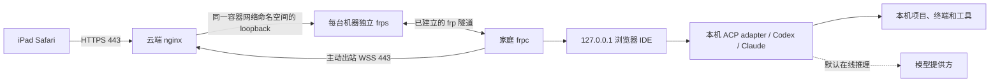

# RemoteCode：iPad 通过公网 IP 驱动家里电脑进行 AI 编码

原方案需要调整：**不要把云端 code-server 当作浏览器中的 Remote SSH 客户端。把浏览器 IDE 放在家庭主机，云端只做 HTTPS 入口和隧道转发。** 本项目按无域名、公网 IPv4、单人使用、多台家庭主机实现，与 UE 无关。



需要纠正的边界：

| 原先的想法 | 实际情况和本项目处理 |
|---|---|
| code-server → open-remote-ssh → 家庭 VS Code Server | open-remote-ssh 面向原生桌面 UI，不是这个浏览器跳转方案；移除此环节。[上游说明](https://github.com/jeanp413/open-remote-ssh/issues/3) |
| Windows 直接安装 Coder code-server | Coder 没有官方 Windows 发布包。使用微软原生 **VS Code Server Web 完整包**，Windows/macOS/Linux 都运行原生扩展宿主。[code-server 安装说明](https://coder.com/docs/code-server/install) |
| 公网零暴露 | 家庭主机没有公网入站；云端仍有一个需要认证的 HTTPS 443 入口。脚本只发布这一个 TCP 端口。 |
| CLI 在本机，所以 AI 算力也在本机 | 文件操作、终端和工具执行在本机；Codex/Claude 默认请求在线模型，相关上下文会发往模型服务。完全本地推理需要另配本地模型和兼容 agent。[Codex CLI 官方文档](https://learn.chatgpt.com/docs/codex/cli) |
| vscode-acp 直接启动任意 CLI | ACP 需要适配器。这里明确使用 `formulahendry.acp-client`，Codex 接 `@agentclientprotocol/codex-acp`，Claude 接 `@agentclientprotocol/claude-agent-acp`；同名扩展不能混用配置。[扩展入口](https://github.com/formulahendry/vscode-acp)、[Codex ACP 当前上游](https://github.com/agentclientprotocol/codex-acp) |

Claude ACP 使用 Claude Agent SDK；Codex ACP 也有自身实现/依赖。不能保证 ACP 内部恰好调用你另外安装的那个 CLI 二进制。若要求“必须执行指定 CLI”，直接使用 IDE 终端中提供的 CLI 命令；ACP 作为可选图形界面。

## 无域名如何访问

浏览器使用 `https://公网IPv4/m/pc1/`，第二台机器使用 `/m/mac1/`。无需注册域名或配置 DNS。

默认生成个人 CA 和包含公网 IP SAN 的服务器证书。把 **`root-ca.crt` 公共证书**安全传送到 iPad，安装描述文件，再在“设置 → 通用 → 关于本机 → 证书信任设置”开启完全信任；必须确认导入的是自己生成的 CA。[Apple 操作说明](https://support.apple.com/en-us/102390)

不要用“跳过证书错误”代替信任配置。浏览器 IDE 需要可靠的 HTTPS 安全上下文。个人 CA 私钥不传给 iPad 或家庭主机。

frpc 直接连接公网 IP，并用 `pc1.tunnel.invalid` 这样的内部 SNI 标签选择该机器的隧道入口。标签只参与 TLS/HTTP 路由，不做 DNS 查询，不要求拥有域名。对应证书由同一私有 CA 签发，frpc 明确校验 CA 和名称。每台机器独立 frps、token、允许端口，转发只绑定 loopback。

也可以为浏览器入口提供已取得的公网 IP 证书。Let's Encrypt 已支持有效期约六天的公网 IP 证书，但续期必须自动化；本项目不代办 ACME 申请。[官方说明](https://letsencrypt.org/2026/01/15/6day-and-ip-general-availability)

## 系统范围

| 角色 | 实现 | 启动与限制 |
|---|---|---|
| 家庭 Windows 10/11、Windows Server 2019+ | 原生 VS Code Web Server + frpc；AI 使用原生 Node.js/CLI | NSSM 运行 frpc；普通开发用户运行 IDE。具体 CLI/系统版本仍以厂商要求为准。 |
| 家庭 macOS Intel/Apple Silicon | 同样使用原生 Web Server + frpc | 用户 LaunchAgents；重启后需要登录，FileVault 解锁不能靠此隧道完成。 |
| 家庭 Linux x64/ARM64 | 原生 Web Server + frpc | systemd 用户服务；无人登录启动需另开 linger。 |
| 云端 Linux x64/ARM64（推荐） | Docker Engine + Compose v2+ 的 Linux 容器 | 开机启动 Docker；容器自动重启。 |
| 云端 macOS / Windows 10、11 | Docker Desktop 的 Linux 容器 | 适合测试/个人使用；Docker Desktop 通常需要用户登录后启动。 |
| 云端 Windows Server | Linux VM 内运行上述云端方案 | 不把 Docker Desktop 或 Windows 容器当作 Windows Server 上的等价实现。虚拟机需正确转发 TCP 443。 |

部署工具使用 Python **3.12+**；一键入口会检查并安装缺失依赖。Ubuntu 22.04+/Debian 12+ 可直接部署：系统 Python 较旧时，自动在工具包的 `.bootstrap/python` 安装已锁定并校验的私有 Python 3.12，保留系统 Python，不添加第三方 PPA。Windows 本机使用 WinGet，macOS 使用 Homebrew。Windows x64 的 NSSM 按微软 manifest 中的哈希自动下载校验。卸载保留共享依赖和私有引导解释器，避免影响其他部署。详情见部署文档中的系统范围和镜像限制。

## 从哪里开始

可以[下载部署工具包](RemoteCode-IP-deployment.zip)及其 [SHA-256](RemoteCode-IP-deployment.sha256)，或克隆仓库：

```bash
git clone https://github.com/lbingasd/RemoteCode.git
cd RemoteCode
```

在解压后或克隆得到的项目根目录运行，示例 IP 必须替换：

```bash
# Linux 云端
sudo bash deploy-cloud.sh install --ip 203.0.113.10 --machine pc1 --cn
```

安全复制云端 `state/cloud/enrollment/pc1/` 到家庭电脑后，在普通 PowerShell：

```powershell
powershell -NoProfile -ExecutionPolicy Bypass -File .\deploy-local.ps1 -Action Install -Bundle .\pc1 -Workspace "$env:USERPROFILE\Projects" -AcceptLicense -CN
```

Mac/Linux 本机对应 `bash deploy-local.sh install --bundle ./mac1 --workspace "$HOME/Projects" --accept-license --cn`，先在云端注册 mac1。重跑保留版本和密钥，下载中断自动续传。AI 登录、iPad 公共 CA 导入仍需本人完成。

启动后显示带时间的依赖/部署阶段，长时间下载或等待会每 10 秒报告耗时，分段下载显示完成比例。若终端只有 `>`，请检查多行命令是否输入完整；[部署文档](docs/deploy.md)提供单行命令与 `tee` 日志用法。

1. [一键部署：依赖、镜像、恢复、云端、本机、iPad](docs/deploy.md)
2. [维护：增删机器、换密钥、升级、证书、卸载](docs/operations.md)
3. [来源与验证记录](docs/verification.md)

| 脚本 | 用途 |
|---|---|
| [deploy-cloud.sh](deploy-cloud.sh) | Linux 云端一键安装、增机器、状态和卸载 |
| [deploy-local.ps1](deploy-local.ps1) / [deploy-local.sh](deploy-local.sh) | Windows / macOS / Linux 本机一键安装、状态和卸载 |
| [setup.py](scripts/setup.py) / [bootstrap-posix.sh](scripts/bootstrap-posix.sh) | 可恢复编排、重复执行保护、系统依赖引导 |
| [download.py](scripts/download.py) / [download-file.py](scripts/download-file.py) | 官方版本锁、校验下载、镜像与可选 VSIX/NSSM 资源 |
| [cloud.py](scripts/cloud.py) | 云端初始化、证书、Compose、机器增删、换密钥、启停和卸载 |
| [local.py](scripts/local.py) | 家庭主机原生 IDE/frpc 安装、配对、诊断和卸载 |
| [local-windows.ps1](scripts/local-windows.ps1) | Windows NSSM 服务和开发用户计划任务 |
| [local-service.py](scripts/local-service.py) | macOS LaunchAgents / Linux systemd 用户服务 |
| [agents.py](scripts/agents.py) | 本机 CLI/ACP 依赖安装、版本锁、启动与设置生成 |

已在当前 Mac 实测完整安装包下载、真实 nginx/frp/双 IDE 链路、浏览器终端与 ACP 视图、CLI 和 ACP 初始化、LaunchAgents 生命周期及清理。未连接或修改你的云服务器、家庭 Windows PC 或 iPad。**Docker 容器运行、Windows 服务、iPad 真机与真实模型任务仍需在目标环境验收，详见验证记录。**

新增一键入口也已在 Mac 实测缓存安装、npm 中断阶段恢复、重复执行、JSONC 设置合并、LaunchAgents 注册与重复卸载；NSSM/ACP 小依赖随包提供并校验。系统依赖管理器的实际安装（apt/Homebrew/WinGet）未在本次执行，以免改动当前共享环境。打包可复现：`python3 scripts/build-package.py`，输出 ZIP 与同名 `.sha256`，不包含运行密钥或大型下载缓存。

这是一个受信任个人使用的入口：云服务器掌握代理流量和隧道配置，管理员可以看到会话内容；同一 IP 下的不同路径也不是浏览器的独立安全来源。不要把它当作互不信任的多租户平台。服务器升级、终端退出和 iPad 后台挂起也不等于 AI 任务必定持续运行，长任务要使用独立进程/任务计划和可恢复的 agent 会话。
