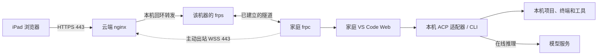

# RemoteCode

通过 iPad 浏览器访问家庭电脑上的 VS Code Web，在家庭电脑上编辑项目、运行终端和使用 Codex / Claude。云服务器提供 HTTPS 入口和隧道转发，支持公网 IPv4、无域名访问，以及多台家庭主机。

## 信息流



- 家庭 frpc 主动连接云端，浏览器请求沿隧道到达家庭 IDE，响应原路返回；家庭网络无需开放公网入站端口。
- 云端只发布 TCP 443；每台机器使用独立隧道、token 和浏览器密码，IDE 与内部转发端口只监听回环地址。
- 项目与工具在家庭电脑运行；Codex / Claude 默认向在线模型发送相关上下文。云端会终止 TLS 并代理流量，适用于受信任的个人多机使用。
- 可选 QQ Bot 由家庭电脑直接连接 QQ，处理 ACP 审批与已授权截图发送；下文介绍安装与配对，详细使用见 [QQ Bot 文档](docs/qq-bot.md)。

## 前置要求与需要你输入的信息

| 位置 | 前置要求 | 你需要输入/准备 |
|---|---|---|
| 云服务器 | Ubuntu 22.04+ / Debian 12+ / RHEL 家族（Rocky、Alma、CentOS Stream 9、Amazon Linux 2023、openEuler 22.03+ 等），x64 或 ARM64；TCP 443 可用 | 公网 IPv4、机器标识（如 `pc1`）、长期 state 目录（建议 `/opt/remotecode-state`） |
| 家庭电脑 | Windows 10/11、macOS 或 Linux，普通开发账号；项目目录与运行目录分开 | 工作区目录（如 `$HOME/Projects`）；默认 AI 部署要求本机 Codex CLI 和 Claude CLI 均已可用 |
| iPad | Safari；个人 CA 需安装并开启完全信任 | 从云端安全取得 `root-ca.crt`，手动导入描述文件 |
| 本机 AI 工具 | 同一开发用户可直接运行 `codex` 和 `claude`，已完成各自配置并能执行模型任务 | 确保两个 CLI 在 PATH 中；仅装桌面 App 不等于 CLI 可调用。部署只检查 CLI 能否执行 `--version`，不会安装 CLI、配置模型或处理认证 |
| 可选 QQ Bot | 已有家庭运行目录、Codex/Claude ACP 条目、Node.js 22+ 和 Python 3.12+ | QQ 开放平台的 AppID、AppSecret、是否沙箱；接收账号具备对应环境的使用权限，并完成单聊绑定 |

依赖会自动补齐：云端检查/安装 curl、CA、OpenSSL、Python 3.12+、Docker Engine 与 Compose 插件；家庭端检查/安装 Python 3.12+、Node.js 22+、Git。不支持自动安装的发行版（openSUSE/SLES、CentOS 7、Amazon Linux 2 等）先预装依赖再加 `--skip-deps`。

Codex CLI 与 Claude CLI 由用户预先准备。检测不到或无法执行时，AI 部署直接报错，不尝试补装。部署安装 ACP 适配器及其 npm 依赖，运行时明确指向已检测到的本机 CLI。仅需远程 IDE 时使用 `-NoAgents -NoExtension` / `--no-agents --no-extension`，可跳过这两个 CLI 的要求。

### 支持的 AI 类型与 QQ 功能

| 类型 | 浏览器 IDE 条目 | QQ 审批条目 | 前置条件 |
|---|---|---|---|
| Codex CLI | `Codex (local ACP)` | `Codex (QQ approvals)` | 本机 Codex CLI 可用，通过 `@agentclientprotocol/codex-acp` 适配 |
| Claude CLI | `Claude (local ACP)` | `Claude (QQ approvals)` | 本机 Claude CLI 可用，通过 `@agentclientprotocol/claude-agent-acp` 适配 |

默认安装同时生成上述两类条目，因此要求两个 CLI 都通过检测；实际使用时可任选其中一类。模型和服务商由本机 CLI 自身配置决定，RemoteCode 不提供模型/服务商配置入口，也不承诺任意兼容服务均可用。

QQ Bot 当前支持这两类 ACP 会话的一次性权限审批和已授权截图发送，须在 IDE 中选择对应的 `QQ approvals` 条目。QQ 不提供新建模型会话或通过聊天提交任意任务的入口，也不接管已有桌面 App、独立终端会话或其他 agent。当前安装器没有其他 AI 类型的自动接入。每台家庭电脑使用独立 QQ Bot AppID。

## 部署（云 → 家庭电脑 → iPad）

以下命令均在工具包根目录执行；`203.0.113.10` 替换为真实公网 IPv4，`pc1` 为每台家庭电脑的独立标识。

先区分三个目录，后续命令不要混用：

| 目录 | Windows 示例 | 用途 |
|---|---|---|
| 工具包目录 | `C:\Users\libing\Documents\RemoteCode` | 本仓库，含部署脚本；在此运行命令 |
| 运行目录 `-Root` | `C:\Users\libing\RemoteCode` | 默认安装位置，保存程序、机器凭据、IDE 数据和日志 |
| 工作区 `-Workspace` | `C:\Users\libing\Projects` | 你的项目代码；必须显式指定，可用已有目录 |

### 1. 安装云端

```bash
git clone https://github.com/lbingasd/RemoteCode.git
cd RemoteCode
sudo bash deploy-cloud.sh install --ip 203.0.113.10 --machine pc1 --state /opt/remotecode-state --cn
```

`deploy-cloud.sh` 依次执行：检测发行版与包管理器并补齐系统依赖 → 引导私有 Python 3.12（系统 Python 不足时）→ 检查/安装 Docker 与 Compose 插件 → 交给 `setup.py cloud` 完成六个阶段（检查 Docker → 下载并校验 frp → 生成个人 CA 与 IP 证书并注册机器 → 锁定并拉取 nginx 镜像 → 校验配置并启动容器 → 显示状态）。中断后原样重跑即可续装。

安装完成后取出：

| 云端文件 | 交给谁 |
|---|---|
| `/opt/remotecode-state/enrollment/pc1/` | 完整目录安全复制到家庭电脑工具包目录，含配对密钥与初始密码 |
| `/opt/remotecode-state/pki/root-ca.crt` | 公共根证书，安全传给 iPad |
| `/opt/remotecode-state/pki/root-ca.key` | CA 私钥，仅云端保存/备份，不外传 |

例如，云端完成安装后，在家庭电脑 PowerShell 中复制配对目录（替换 SSH 用户和 IP；该用户必须有权读取导出目录）：

```powershell
scp -r deploy@203.0.113.10:/opt/remotecode-state/enrollment/pc1 .\pc1
```

`-Bundle` 必须指向直接包含 `machine.json` 和 `ca.pem` 的那一层目录。如果复制后路径是 `win1-enrollment\win1\machine.json`，则应传 `-Bundle .\win1-enrollment\win1`，而不是上一级目录。配对包含密钥和密码，不要提交到 Git 或公开分享。

- 443 已被宿主机 nginx 等占用时，先 `sudo ss -ltnp 'sport = :443'` 确认占用者，再决定是否 `sudo systemctl disable --now nginx` 后重跑原命令；脚本不自动停止现有服务。安全组最终只公开 TCP 443。
- `--cn` 启用国内依赖镜像与 GitHub Release 多源（Python/Compose/frp）及默认 nginx 容器镜像切换；文件仍校验官方 SHA-256，镜像仍按固定 digest 拉取。

### 2. 安装家庭电脑

将工具包解压（或克隆）到家庭电脑，把云端导出的 `pc1` 配对目录放到工具包根目录。

Windows（普通开发账号 PowerShell，注册服务时按提示授权 UAC）：

```powershell
powershell -NoProfile -ExecutionPolicy Bypass -File .\deploy-local.ps1 -Action Install -Bundle .\pc1 -Workspace "$env:USERPROFILE\Projects" -AcceptLicense -CN
```

上面是一行完整命令。`-Action Install` 是默认动作，可以省略；`-Root`、`-Cache` 有默认值，也可以省略。**`-Bundle`、`-Workspace` 和 `-AcceptLicense` 三项不能省略**，所以仅运行 `.\deploy-local.ps1` 会提示缺少安装参数。`-CN` 是可选的下载镜像开关，不影响机器身份。

如果你的配对目录叫 `win1-enrollment\win1`，直接使用：

```powershell
powershell -NoProfile -ExecutionPolicy Bypass -File .\deploy-local.ps1 -Bundle .\win1-enrollment\win1 -Workspace "$env:USERPROFILE\Projects" -AcceptLicense -CN
```

macOS / Linux（以当前开发用户执行，不要 sudo）：

```bash
bash deploy-local.sh install --bundle ./pc1 --workspace "$HOME/Projects" --accept-license --cn
```

`deploy-local.sh` / `deploy-local.ps1` 依次执行：补齐 Python/Node/Git（Windows 走 WinGet，macOS 走 Homebrew，Linux 同云端依赖范围）→ 检查本机 Codex/Claude CLI（缺失或无法执行则报错）→ 下载并校验 VS Code Web Server 与 frpc → 创建运行目录与工作区 → 安装 ACP 适配器并指向本机 CLI → 合并远程 IDE 设置、安装 ACP 扩展与 Safari 布局兼容补丁 → 注册系统服务/任务并 `doctor` 健康检查。`-AcceptLicense`/`--accept-license` 表示接受微软 VS Code Server 许可；`--cn`/`-CN` 启用国内镜像，`npm` 走 npmmirror。

- 默认运行目录为用户主目录下的 `RemoteCode`，工作区为 `--workspace` 指定目录，二者必须互相独立且不能互相包含。
- 中断后原样重跑；已安装运行目录保留版本、密钥、项目和 IDE 数据。需要离线或跳过依赖安装时用 `--offline` / `--skip-deps`（Windows `-Offline` / `-SkipDeps`）。
- 只想用 IDE、不装 AI 组件时加 `--no-agents --no-extension`。

Windows 默认创建 `RemoteCode-frpc-<机器标识>` 系统服务和 `RemoteCode-IDE-<机器标识>` 计划任务：frpc 以 LocalService 运行，IDE 以当前开发用户运行，默认需要该用户登录。仅注册服务步骤会弹 UAC，安装命令本身应在普通 PowerShell 中运行。需要 IDE 在未登录时随开机启动，可加 `-Headless`，并在提示时输入同一 Windows 账号的密码（不是 PIN）。这不会改变 QQ Bot 的登录后启动方式。

安装结束后应看到健康检查成功及访问地址。Windows 可再次执行：

```powershell
powershell -NoProfile -ExecutionPolicy Bypass -File .\deploy-local.ps1 -Action Status
python .\scripts\local.py url --show-secrets
```

若安装时指定了自定义 `-Root`，后续状态、QQ 和卸载命令也要指向同一个目录；底层 Python 脚本的 `--root` 放在子命令前，例如 `python .\scripts\local.py --root D:\RemoteCodeRuntime url --show-secrets`。`Status` 检查服务与本机 IDE/云端 TLS；浏览器访问和模型回复仍需按第 3 步验收。

### 新增第二台家庭电脑

云端部署完成后，用新的机器标识（如 `pc2`）重跑云端安装即可注册新机器并导出配对包，复用已有 frp、CA 与 nginx 镜像：

```bash
sudo bash deploy-cloud.sh install --ip 203.0.113.10 --machine pc2 --state /opt/remotecode-state --cn
```

脚本检测到 state 已存在，会复用已有部署，在“检查/注册设备”阶段添加 `pc2` 并应用配置（已有连接短暂重连）。**必须继续使用原来的公网 IP 和 state 目录**；每次 `install` 都需要 `--ip`，同名机器会保留原有凭据，不会成为新设备。机器标识须为 1–25 位小写字母、数字或连字符，以字母开头。

完成后把 `/opt/remotecode-state/enrollment/pc2/` 复制到第二台电脑，再执行：

```powershell
powershell -NoProfile -ExecutionPolicy Bypass -File .\deploy-local.ps1 -Bundle .\pc2 -Workspace "$env:USERPROFILE\Projects" -AcceptLicense -CN
```

两台电脑各自使用自己的配对包，浏览器分别访问 `https://公网IPv4/m/pc1/` 和 `https://公网IPv4/m/pc2/`，账号密码也按各自配对信息使用。不要把 `pc1` 的包复制给第二台电脑作为新身份。撤销机器见下文“日常维护”。

### 3. 从 iPad 访问

在家庭电脑交互终端查看初次访问链接与浏览器密码：

```bash
python3 scripts/local.py url --show-secrets
```

Windows 把 `python3` 换成 `python`。凭据只在自己终端查看，不公开转发。

iPad 步骤：

1. 安装 `root-ca.crt` 描述文件，并在“设置 → 通用 → 关于本机 → 证书信任设置”开启完全信任。
2. 打开终端给出的初次 token 链接，输入浏览器账号密码；之后收藏不含 token 的 `https://公网IPv4/m/pc1/`。
3. 在 **ACP Client → Agents** 连接 **Codex (local ACP)** 或 **Claude (local ACP)**，执行 **ACP: Open Chat Panel** 开始使用。
4. 在 IDE 终端执行 `hostname` 确认是家庭电脑，再验证编辑、模型回复、权限确认和断线重连。

### 4. 可选：追加 QQ Bot

先完成家庭端安装（包括 agents），再在同一开发用户的交互终端运行；无需重新部署云端：

```powershell
powershell -NoProfile -ExecutionPolicy Bypass -File .\deploy-qq.ps1 -Action install
```

macOS / Linux 对应 `bash deploy-qq.sh install`。自定义运行目录时，Windows 追加 `-Root D:\RemoteCodeRuntime`，macOS/Linux 追加 `--root /path/to/runtime`。

1. 脚本安装本机 QQ 组件、QQ 审批专用 ACP 条目和截图 skill，并启动本机 Bot。
2. 首次安装时交互输入 AppID、隐藏输入 AppSecret；沙箱测试输入 `y`，正式发布/已授权使用环境输入 `N` 或直接回车。发送 QQ 消息的账号必须有该环境的测试/使用权限。
3. 通过 QQ 官方验证后将凭据保存在本机并重启 Bot；已有配置的安装重跑会复用凭据，需要修改时单独运行 `configure`。
4. 未绑定时显示 `绑定 <配对码>`；在 5 分钟内用接收通知的 QQ 账号私聊当前 Bot，完整发送该命令。超时后运行 `pair` 重新生成。
5. 运行 `status` 检查 `configured`、`online`、`bound`，然后在 IDE 选择 **Codex (QQ approvals)** 或 **Claude (QQ approvals)**，重新连接会话。

```powershell
powershell -NoProfile -ExecutionPolicy Bypass -File .\deploy-qq.ps1 -Action status
powershell -NoProfile -ExecutionPolicy Bypass -File .\deploy-qq.ps1 -Action configure
powershell -NoProfile -ExecutionPolicy Bypass -File .\deploy-qq.ps1 -Action pair
```

以上分别用于查状态、修改凭据、重新配对，按需要执行即可。`configured=true` 代表已读到配置，`online=true` 代表网关已 READY，`bound=true` 代表已有接收账号；它们不能单独证明审批/截图已在手机上成功收发。AppSecret 只在自己终端隐藏输入，不放进命令、聊天或日志。

## 脚本说明

| 脚本 | 过程与输入 | 副作用 |
|---|---|---|
| `deploy-cloud.sh` | 云网关入口。阶段：系统依赖 → 私有 Python → Docker/Compose → `setup.py cloud`（六阶段）。输入：`--ip`（公网 IPv4，必填）、`--machine`、`--state`、`--cn`、`--skip-deps`、`--offline` 等 | 安装/补齐共享系统依赖与 Docker 插件；不改系统源、不替换已有 Docker、不自动停现有服务 |
| `deploy-local.sh` / `deploy-local.ps1` | 家庭端入口。阶段：依赖 → 前置 CLI 检测 → IDE/frpc → 运行目录 → ACP 适配器 → 远程设置/扩展 → 服务注册 → doctor。输入：`--bundle`、`--workspace`、`--accept-license`、`--cn` 等 | 安装 VS Code Web、frpc、ACP 适配器与扩展；注册服务/任务（Windows frpc 为系统服务）；不触碰 `.codex`/`.claude` 登录资料 |
| `deploy-qq.sh` / `deploy-qq.ps1` | 对已有家庭运行目录追加 QQ Bot（见 [QQ Bot 文档](docs/qq-bot.md)）。交互输入 AppID/AppSecret/沙箱，验证鉴权后写配置并启动 | 只改家庭端；不修改云端/IDE/frp |

### 云端参数：`deploy-cloud.sh`

语法为 `sudo bash deploy-cloud.sh <install|status|uninstall> [参数]`，动作必须填写。下面的默认目录均以工具包所在目录为基准，不随当前 shell 目录改变。

| 参数 | 默认值 / 必填条件 | 说明 |
|---|---|---|
| `--ip IPv4` | 每次 `install` 必填 | 云端公网 IPv4；重跑必须与已有 state 一致 |
| `--machine ID` | `pc1` | 本次注册的家庭机器标识；新增电脑时换成新的 ID |
| `--state DIR` | `<工具包>/state/cloud` | 长期状态、证书、配对包和容器配置目录；推荐显式用 `/opt/remotecode-state`，所有维护命令保持一致 |
| `--image REF` | 首次默认 `nginx:stable-alpine` | 自选 nginx 镜像来源，拉取后固定 digest；已有部署不会隐式升级镜像 |
| `--cert FILE`、`--key FILE` | 不填则生成个人 CA/IP 证书 | 使用外部 IP 证书时成对提供；已有部署换证书用 `cloud.py renew-cert` |
| `--cn` | 关闭 | 启用国内依赖/下载镜像及默认 nginx 多源，保留哈希校验 |
| `--skip-deps` | 关闭 | 不调用系统依赖安装；须已有 Python 3.12+、Docker/Compose、OpenSSL 等；仍可下载部署资源 |
| `--offline` | 关闭 | 跳过系统依赖安装，使用已校验缓存和预先 `docker load` 的镜像；不是自动准备离线包 |
| `--cache DIR`、`--lock FILE` | `<工具包>/downloads`；按平台选 lock | 缓存资源和指定版本清单；详见下方下载参数 |
| `--mirror URL`、`--workers N`、`--simple-download` | 不指定镜像；8；关闭 | 下载行为，与家庭端同名参数一致 |
| `--purge` | 关闭，仅 `uninstall` 可用 | 删除专用 state 和本次指定的下载缓存；同时删除其中证书、密钥和配对包 |
| `--help` | — | 显示入口帮助，不安装依赖 |

### 家庭端参数：`deploy-local.ps1` / `deploy-local.sh`

Windows 语法为 `.\deploy-local.ps1 -Action <Install|Status|Uninstall> [参数]`，默认 `Install`。macOS/Linux 为 `bash deploy-local.sh <install|status|uninstall> [参数]`，动作必须填写。开关只写名称，不要在后面加 `true`；路径含空格时用引号包住。

| PowerShell 参数 | Bash 参数 | 默认值 / 用法 |
|---|---|---|
| `-Bundle DIR` | `--bundle DIR` | 安装必填；云端导出的机器目录，直接包含 `machine.json`、`ca.pem` |
| `-Workspace DIR` | `--workspace DIR` | 安装必填，无默认值；项目目录，不存在会创建，须与运行目录互不包含 |
| `-AcceptLicense` | `--accept-license` | 安装必填；明确接受微软 VS Code Server 许可 |
| `-Root DIR` | `--root DIR` | 默认当前用户主目录下 `RemoteCode`；用于安装、状态、卸载，不能指向工具包目录 |
| `-CN` | `--cn` | 可选；启用国内下载策略，npm 默认切换到 npmmirror |
| `-SkipDeps` | `--skip-deps` | 跳过系统包管理器，依赖须已就绪；不会禁止联网下载 IDE、适配器等 |
| `-Offline` | `--offline` | 只使用已有依赖和缓存；需提前准备对应平台的 lock、IDE/frp/NSSM、VSIX 和 npm 缓存；不能同时启用 QQ 安装 |
| `-NoAgents` | `--no-agents` | 跳过本机 CLI 检测、ACP 适配器安装与设置合并；不自动跳过扩展，纯 IDE 可同时加 `-NoExtension` |
| `-NoExtension` | `--no-extension` | 跳过 ACP 扩展安装；不自动跳过 agents |
| `-NoService` | `--no-service` | 安装时不注册/启动 IDE 和 frpc，也不执行安装末尾的 doctor；需自行启动。状态时跳过服务管理器检查；卸载仍会移除已管理服务 |
| `-Headless` | `--headless` | 仅 Windows IDE 开机任务使用，需要同一开发账号密码与 UAC；切换已有任务模式需先移除旧任务；不代表 macOS/QQ 支持未登录运行 |
| `-QQBot` | `--qq-bot` | 追加 QQ 组件及交互配置/配对；需要 agents、网络；配合 `-NoService` 时只安装 QQ 组件，不启动或询问凭据 |
| `-Vsix FILE`、`-VsixSha256 HASH` | `--vsix FILE`、`--vsix-sha256 HASH` | 自备 ACP 扩展时同时提供文件及可信 SHA-256；否则使用随包/锁定的扩展资源 |
| `-NssmPath FILE`、`-NssmSha256 HASH` | `--nssm-path FILE`、`--nssm-sha256 HASH` | Windows 自备 NSSM 可执行文件及可信 SHA-256；Windows x64 默认按 lock 自动准备 |
| `-Purge` | `--purge` | 仅卸载可用；删除专用运行目录及指定缓存。项目与共享 CLI 登录资料保留 |
| `-Help` | `--help` | 显示帮助；不开始安装 |

下载参数（云端同名 Bash 参数也适用）：

| PowerShell / Bash | 默认值 | 说明 |
|---|---|---|
| `-Cache DIR` / `--cache DIR` | `<工具包>/downloads` | 缓存与运行目录必须互不包含。安装时用了自定义缓存，彻底卸载时也要指定同一路径 |
| `-Lock FILE` / `--lock FILE` | 按目标系统/架构选择随包 lock | 首次安装可指定已验证版本清单；重跑优先保留运行目录内的 lock，不支持用不同 lock 原地升级 |
| `-Mirror URL` / `--mirror URL` | 未指定 | 自己信任的 HTTPS 下载镜像模板，必须包含且仅包含一个 `{url}`，例如 `https://mirror.example/{url}`；不改变期望 SHA-256 |
| `-Registry URL` / `--registry URL` | `https://registry.npmjs.org` | npm registry；`-CN` 时默认 `https://registry.npmmirror.com`，显式值优先；要求无凭据的 HTTPS URL |
| `-Workers N` / `--workers N` | `8` | 分段下载并发数，范围 1–16 |
| `-SimpleDownload` / `--simple-download` | 关闭 | 改用普通校验续传，适用于 Range 分段下载不兼容的源 |

Python 查找异常时，可在当前 PowerShell 中设置实际解释器路径，例如 `$env:REMOTECODE_PYTHON = 'C:\Python314\python.exe'`，再运行入口脚本；该解释器需为 Python 3.12+。这不是让你填写 WindowsApps 的商店占位程序。

macOS/Linux 入口还支持 `--codex-path FILE`、`--claude-path FILE`，显式指定已有 CLI 绝对路径；省略则从 PATH 检测。这两个选项目前没有对应的 `deploy-local.ps1` 参数，Windows 可先把已有 CLI 加入 PATH，再重新打开普通 PowerShell 安装。

### QQ 参数与动作：`deploy-qq.ps1` / `deploy-qq.sh`

Windows 用 `-Action 动作`（默认 `install`），Bash 用位置参数动作（无参数也默认 `install`）。默认运行目录均为当前用户主目录下 `RemoteCode`。

| 动作 / 参数 | 作用 |
|---|---|
| `install` | 安装/更新本机 QQ 组件、受管理的 ACP 条目和 skill；默认启动服务，无配置时交互配置，未绑定时进入配对 |
| `configure` | 交互更新 AppID/AppSecret/沙箱并验证，成功后重启；未绑定则进入配对。已有 AppID/Secret 可留空保留，沙箱仍需按提示选择；切换 AppID 或沙箱环境会清除原绑定 |
| `pair` | 生成一次性配对码并等待 QQ 私聊；已有绑定时须输入 `REBIND` 才更换接收人 |
| `status` | 显示配置/在线/绑定状态、事件计数和诊断，不显示凭据；本机服务未运行时返回失败 |
| `start` / `stop` / `restart` | 控制本机 QQ 服务/任务，不影响 IDE 或 frpc |
| `unbind` | 清除 QQ 绑定、待审批和截图；保留 Bot 配置，可再运行 `pair` |
| `uninstall` | 移除 QQ 服务、未被自行修改的受管理 agent/skill、QQ 凭据和绑定；保留 IDE/frpc |
| `-Root DIR` / `--root DIR` | 指向已经安装家庭端的运行目录，必须含 `local.json`；不是本仓库路径 |
| `-NoConfigure` / `--no-configure` | 仅对 `install` 生效；跳过交互配置和配对，默认仍启动 Bot；之后用 `configure` 完成配置 |
| `-NoService` / `--no-service` | 仅对 `install` 生效；只部署组件，跳过服务启动、配置和配对 |

审批方式、截图授权、权限边界及详细排障见 [docs/qq-bot.md](docs/qq-bot.md)。

## 日常维护

| 操作 | 命令 |
|---|---|
| 查看状态 | 云 `sudo bash deploy-cloud.sh status --state /opt/remotecode-state`；家庭 `bash deploy-local.sh status`（Windows `-Action Status`） |
| 新增一台机器 | 云端 `sudo bash deploy-cloud.sh install --ip 203.0.113.10 --machine pc2 --state /opt/remotecode-state --cn`，复制 `enrollment/pc2/` 到新电脑 |
| 撤销机器 | 云端 `sudo python3 scripts/cloud.py --state /opt/remotecode-state remove pc1`，再运行下面的 `up` 应用 |
| 轮换凭据 | 云端 `sudo python3 scripts/cloud.py --state /opt/remotecode-state rotate pc1`，再 `up`；家庭端须停机，用新配对包执行 `local.py --root <运行目录> pair --bundle <新包目录>`，并重建 Windows 服务副本后启动 |
| 应用云端更改 | `sudo python3 scripts/cloud.py --state /opt/remotecode-state up`；会短暂断开现有浏览器连接 |
| 续期证书 | `sudo python3 scripts/cloud.py --state /opt/remotecode-state renew-private-cert`；外部证书用 `renew-cert --cert <证书文件> --key <私钥文件>`；命令会校验并 reload nginx |
| 卸载（保留运行数据） | 云 `sudo bash deploy-cloud.sh uninstall --state /opt/remotecode-state`；家庭 `bash deploy-local.sh uninstall`；Windows `.\deploy-local.ps1 -Action Uninstall` |
| 彻底清理 | 在上面的卸载命令加 `--purge` / `-Purge`；自定义缓存时同时传 `--cache` / `-Cache` |

- 卸载默认停用并移除本项目运行项/容器，保留运行目录和下载缓存；加 `--purge`/`-Purge` 才删除专用 state/root 与下载缓存（`downloads/`）。共享的 Python、Node、Git、Docker、软件源、项目及 `.codex`/`.claude` 认证资料始终保留。
- 升级不自动滚动：使用新的 download lock 安装到新目录并重新配对；具体见下方验证范围。个人叶子证书有效期 365 天、CA 十年。

上述云端底层 Python 命令需要 Python 3.12+；若系统 `python3` 版本不足，改用部署时准备的解释器绝对路径。普通家庭端卸载也会移除 QQ 组件及其凭据/绑定，即使没有使用 `-Purge`；需要保留的 QQ 配置应提前自行备份。

## 常见部署问题

| 现象 | 检查与处理 |
|---|---|
| `Install requires -Bundle, -Workspace and -AcceptLicense` | 使用上面的完整安装命令；这三项没有可代替的默认值 |
| `Join-Path ... Path ... empty string`，位置在 `$PSScriptRoot` | 更新到当前脚本；默认缓存已改为在参数绑定完成后初始化。旧版临时绕过可显式传 `-Cache "$PWD\downloads"` |
| 提示工作区/安装目录不能互相包含 | `-Root` 是运行程序目录，`-Workspace` 是项目目录；Windows 的 `RemoteCode` 与 `remotecode` 是同一路径，换成 `Projects` 等独立目录 |
| `Bundle must contain machine.json...` 或找不到配对文件 | 检查 `-Bundle` 是否多/少了一层目录；完整复制同一台机器的导出目录，不要只复制 JSON |
| `缺少或无法执行前置 CLI: codex, claude` | 在同一开发用户终端确认 `codex --version`、`claude --version` 可执行，并检查 PATH 或显式 CLI 路径；部署脚本不会安装这两个 CLI。纯 IDE 使用 `-NoAgents -NoExtension` |
| Windows 解压/启动出现 `Access denied` 或文件消失 | 使用当前版本修复的 ACL 流程；同时查看 Windows 安全中心保护历史是否隔离了 frp。先确认文件来源与 lock 哈希；脚本不自动关闭防护或添加排除项 |
| 云端 443 被占用 | 用 `sudo ss -ltnp 'sport = :443'` 找到占用者；处理现有服务冲突后重跑，不要另建 state 来绕过 |
| 安装完成但 doctor 失败 | 检查云端 `status`、Windows 服务/任务和网络；自定义路径始终传同一个 `-Root`。Windows frpc 日志在 `%ProgramData%\RemoteCode\<机器标识>\logs`，QQ 日志在 `<Root>\logs\qq.err.log` / `qq.out.log` |
| QQ 已显示“凭据验证成功”，随后仍提示“请先 configure” | 先用相同 `-Root` 查 `status`。旧版 Windows runner 可能因正常 stderr 输出退出而留下旧 Node 进程；更新后用 `.\deploy-qq.ps1 -Action install -NoConfigure` 重新部署 runner，再运行 `-Action restart` 并查看 `configured`。若仍为 false，需按部署记录核实并处理旧进程，不能只反复输入 Secret 或结束所有 Node 进程 |
| QQ 在线但一直等不到绑定 | 私聊正确 AppID/沙箱环境的 Bot，确认 QQ 账号有测试/使用权限，发送终端显示的最新完整绑定命令；检查单聊事件计数，超时后 `pair` 重试 |

安装中断时先解决提示的原因，再使用相同机器、目录和参数重跑；不要删除运行目录来尝试恢复，否则会丢失已有凭据和 IDE 数据。

## 验证范围

已在本机 macOS 用真实原生栈验证：nginx HTTPS → frps → frpc WSS → VS Code Web 的链路、浏览器 IDE 与终端、ACP 扩展与 WebView、Codex/Claude ACP 的协议 1 `initialize`（未登录模型账号）、macOS LaunchAgents 生命周期、一键安装/重跑/卸载、WebView 布局兼容补丁。证据在 [docs/evidence/](docs/evidence/)。

2026-10-23 已在 Windows 实机完成家庭端安装、frpc/NSSM 服务与 IDE 计划任务启动、IDE HTTP 与云端 TLS 健康检查，以及 QQ 组件部署、真实凭据校验和网关上线。另通过 25 项 Python 定向测试、34 项 Node QQ 测试和 PowerShell 语法/参数转义检查；详见 [Windows 验证记录](docs/evidence/windows-deployment.md)。自动化 QQ 测试使用模拟 QQ 接口，不能代替手机验收。

尚未验收（需目标环境）：Linux Docker 容器运行、RHEL 家族云端自动安装、Linux systemd、Windows 重启/注销/Headless 与完整卸载生命周期、当前 Windows QQ 的手机绑定/审批/截图往返、Codex/Claude/ACP 真实模型任务、iPad Safari/蜂窝网络/长期任务恢复和多物理机切换。已完成的单机检查不代表上述场景全部通过。

## 开源协议

RemoteCode 自有代码和文档采用 [MIT License](LICENSE)。协议原文见仓库根目录 `LICENSE`；分发副本时保留其中的版权与许可声明。协议参考 [Open Source Initiative 的 MIT 原文](https://opensource.org/license/mit)。

随包的 NSSM、ACP Client 扩展，以及部署时下载的 VS Code Server、frp、ACP 适配器等第三方组件，分别适用各自的许可与使用条款，不因本项目采用 MIT 而改变。随包资源来源与原许可位置见 [assets/README.md](assets/README.md)；安装 VS Code Server 仍需显式传入 `-AcceptLicense` / `--accept-license`。

发布仓库或工具包时只分发源代码、公开资源与脱敏验证记录；不要加入云端 state、家庭运行目录、机器配对包、私钥、QQ AppSecret、模型凭据、含 token 的链接或日志。2026-10-23 已检查当前跟踪文件、部署归档和本地可达 Git 历史，未发现真实私钥或凭据；扫描范围及截图中保留的本机标识见 [发布内容检查记录](docs/evidence/publication-review.md)。

## 参考

- [QQ Bot 安装、绑定、审批与截图](docs/qq-bot.md)
- [随包资源来源与许可](assets/README.md)
- [ACP 协议](https://agentclientprotocol.com/)、[Codex CLI](https://learn.chatgpt.com/docs/codex/cli)、[Claude Code](https://code.claude.com/docs/en/setup)
