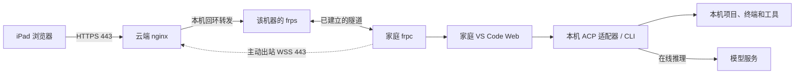

# RemoteCode

通过 iPad 浏览器访问家庭电脑上的 VS Code Web，在家庭电脑上编辑项目、运行终端和使用 Codex / Claude。云服务器提供 HTTPS 入口和隧道转发，支持公网 IPv4、无域名访问，以及多台家庭主机。

## 信息流



- 家庭 frpc 主动连接云端，浏览器请求沿隧道到达家庭 IDE，响应原路返回；家庭网络无需开放公网入站端口。
- 云端只为本项目发布 TCP 443；每台机器使用独立隧道、token 和浏览器密码，IDE 与内部转发端口只监听回环地址。
- 项目和工具在家庭电脑运行；Codex / Claude 默认向在线模型发送相关上下文。云端会终止 TLS 并代理流量，适用于受信任的个人多机使用。
- 可选 [QQ Bot](docs/qq-bot.md) 由家庭电脑直接连接 QQ，处理 ACP 审批与已授权截图发送。

代码调用关系、配置生成和数据位置见[代码结构与信息流](docs/architecture.md)。

## 部署

按“云端 → 家庭电脑 → iPad”的顺序操作。以下命令均在工具包根目录执行，`203.0.113.10` 必须替换为真实公网 IPv4；`pc1` 是机器标识，每台家庭电脑使用不同标识。

| 位置 | 准备条件 |
|---|---|
| 云端 | Ubuntu 22.04+ / Debian 12+ / RHEL 家族（Rocky、Alma、CentOS Stream 9 等），x64 或 ARM64；TCP 443 可用，安全组/防火墙允许该入口 |
| 家庭电脑 | Windows 10/11、macOS 或 Linux；以普通开发用户安装，项目目录与 RemoteCode 运行目录分开 |
| iPad | Safari；默认使用个人 CA，需要安装并信任公共根证书 |

入口会检查并补齐 Python 3.12+、云端 Docker/Compose，以及家庭端 Node.js 22+ / Git 等依赖。其他系统、架构与启动限制见[详细部署说明](docs/deploy.md)。

### 1. 安装云端

下载并解压[部署工具包](RemoteCode-IP-deployment.zip)（[SHA-256](RemoteCode-IP-deployment.sha256)），或克隆仓库：

```bash
git clone https://github.com/lbingasd/RemoteCode.git
cd RemoteCode
sudo bash deploy-cloud.sh install --ip 203.0.113.10 --machine pc1 --state /opt/remotecode-state --cn
```

安装完成后取出：

| 云端文件 | 交给谁 |
|---|---|
| `/opt/remotecode-state/enrollment/pc1/` | 完整目录安全复制到家庭电脑的工具包目录，包含配对密钥和初始密码 |
| `/opt/remotecode-state/pki/root-ca.crt` | 公共根证书，安全传给 iPad |

CA 私钥 `pki/root-ca.key` 留在云端。脚本不修改云安全组或停止现有服务；443 被占用时，按[端口冲突说明](docs/deploy.md#443-已被-nginx-或其他服务占用)处理后重跑。

### 2. 安装家庭电脑

在家庭电脑也解压工具包或克隆仓库，将 `pc1` 配对目录放到工具包根目录。按系统选择以下命令。

Windows：在普通开发账号的 PowerShell 中执行，注册服务时按提示授权 UAC：

```powershell
powershell -NoProfile -ExecutionPolicy Bypass -File .\deploy-local.ps1 -Action Install -Bundle .\pc1 -Workspace "$env:USERPROFILE\Projects" -AcceptLicense -CN
```

macOS / Linux：以当前开发用户执行：

```bash
bash deploy-local.sh install --bundle ./pc1 --workspace "$HOME/Projects" --accept-license --cn
```

`-AcceptLicense` / `--accept-license` 表示接受微软 VS Code Server 许可。默认运行目录为用户主目录下的 `RemoteCode`，`Projects` 为工作区。安装器配置原生 VS Code Web、frpc、CLI、ACP 适配器和扩展，并注册运行项。默认 Windows IDE 和 macOS 服务需要用户登录；Linux 无人登录启动需配置 linger，详见部署文档。

`--cn` / `-CN` 启用国内依赖与下载镜像，文件仍校验 SHA-256，云端镜像固定 digest。下载中断后原样重跑，保留已有版本和密钥；自定义镜像、缓存与离线安装见[部署选项](docs/deploy.md#重复执行续传和离线)。

### 3. 登录 AI 并从 iPad 访问

在家庭电脑的交互终端中，按需登录 Codex 或 Claude，并查看初次访问链接和密码：

```bash
python3 scripts/agents.py exec codex -- login
python3 scripts/agents.py exec claude
python3 scripts/local.py url --show-secrets
```

Windows 将 `python3` 换成 `python`；自定义安装目录时，在脚本名后、子命令前增加 `--root DIR`。凭据只在自己的终端查看，完整登录步骤见[AI 登录与 iPad 接入](docs/deploy.md#ai-登录与-ipad-接入)。

1. 在 iPad 安装 `root-ca.crt` 描述文件，并在“设置 → 通用 → 关于本机 → 证书信任设置”开启完全信任。
2. 打开终端给出的初次 token 链接，输入浏览器账号密码；之后收藏不含 token 的 `https://公网IPv4/m/pc1/`。
3. 在 **ACP Client → Agents** 连接 **Codex (local ACP)** 或 **Claude (local ACP)**，执行 **ACP: Open Chat Panel** 开始使用。
4. 在 IDE 终端执行 `hostname` 确认主机，再验证编辑、模型回复、权限确认和断线重连。

## 文档索引

| 文档 | 内容 |
|---|---|
| [代码结构与信息流](docs/architecture.md) | 运行链路、部署编排、模块职责和数据位置 |
| [详细部署](docs/deploy.md) | 系统依赖、镜像、离线、状态查询与卸载 |
| [日常维护](docs/operations.md) | 增删机器、轮换密钥、证书、升级和回滚 |
| [QQ Bot](docs/qq-bot.md) | 可选安装、账号绑定、审批和截图 |
| [来源与验证记录](docs/verification.md) | 上游依据、测试证据及尚待验收的范围 |

Windows 服务、云端 Docker 生命周期和真实模型任务的验收状态以验证记录为准。
