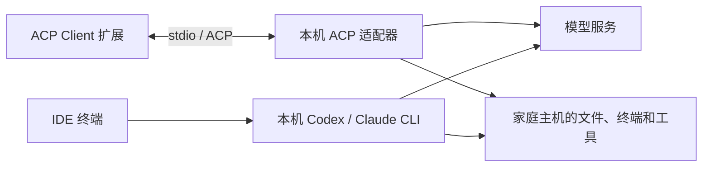

# 代码结构与信息流

本项目由云端网关、家庭开发主机和浏览器客户端组成。以下按当前代码的调用关系说明；操作命令见[部署](deploy.md)，验收证据见[验证记录](verification.md)。

## 运行时信息流

### 浏览器到家庭 IDE

1. 家庭端 `local.py` 生成 `frpc.toml`，frpc 直接连接云端公网 IP 的 443，通过 WSS 建立出站隧道。`机器名.tunnel.invalid` 仅用于 TLS SNI 路由与证书校验，不查询 DNS。
2. 云端 `cloud.py` 生成 nginx 配置，将对应 SNI 的 `/~!frp` 请求转发到该机器的 frps。每台机器的 frps 与 nginx 共享容器网络命名空间，只监听回环地址，并限制 token 与允许转发的端口。
3. iPad 访问 `https://公网IP/m/机器名/`。nginx 完成 TLS 和该机器的 Basic Auth 校验，再转发到 frps 在回环地址上开放的代理端口。
4. frps 经已建立的隧道将请求送到家庭 frpc，frpc 再连接 `127.0.0.1:18080` 的 VS Code Web。IDE 使用独立连接 token，并按 `/m/机器名` 提供页面与 WebSocket。
5. 页面、文件编辑和终端交互的响应沿原链路返回。家庭端的 IDE/frpc 由系统服务管理器维持运行。

云端会解密并代理浏览器流量，云管理员属于信任边界；同一公网 IP 下的不同机器路径属于同一浏览器 origin，适用于同一受信任用户的多机访问。

### IDE 到 AI 工具



`agents.py` 将 CLI 与适配器安装到家庭运行目录中的 `agents/`，生成 `acp-settings.json`；`setup.py` 将配置合并到 IDE 实际读取的 `data/data/Machine/settings.json`，保留用户设置并备份。扩展使用 `formulahendry.acp-client`，分别启动 `@agentclientprotocol/codex-acp` 和 `@agentclientprotocol/claude-agent-acp`。

ACP 适配器与终端 CLI 是两个入口，适配器内部不保证调用另装的 CLI 二进制。工具操作发生在家庭主机；默认推理请求发送到模型提供方。适配器连接成功只证明协议链路可用，账号认证、模型响应和工具执行须分别验证。

### 可选 QQ 审批与截图

选择 **Codex (QQ approvals)** 或 **Claude (QQ approvals)** 后，链路为 `ACP Client → acp_qq_proxy.py → 原 Codex/Claude ACP adapter`。代理透传普通 ACP 消息，只将 `session/request_permission` 交给家庭端 QQ Bot 的受认证回环 HTTP 接口。Bot 主动连接 QQ WebSocket / HTTPS，将绑定用户的一次性选择交回同一个 ACP 请求，不另建模型会话。

尚未进入 QQ 通道时，服务不可用、未绑定或推送失败会回到 IDE；进入 QQ 通道后超时、失联或会话取消会取消请求。截图由获授权的本机调用上传至 QQ，不自动截取桌面。此链路不经过云端网关；配置、绑定和限制见 [QQ Bot 文档](qq-bot.md)。

## 部署调用关系

```text
云端 deploy-cloud.sh / 家庭端 deploy-local.sh
  └─ bootstrap-posix.sh：系统依赖与 Python 引导
      └─ setup.py cloud|local install|status|uninstall

Windows 家庭端 deploy-local.ps1
  └─ WinGet 依赖引导与参数传递
      └─ setup.py local install|status|uninstall
```

`setup.py` 负责部署目录校验、互斥锁、下载缓存和阶段恢复，再调用各领域脚本：

| 阶段 | 云端 `cloud_setup()` | 家庭端 `home_setup()` |
|---|---|---|
| 准备 | 检查 Linux Docker、架构和 443 占用 | 检查许可、工作区、配对包和平台 |
| 安装核心程序 | 下载 frps；`cloud.py init` 生成 CA、证书和 state | 下载 IDE/frpc；`local.py install` 创建运行目录 |
| 配置 | `cloud.py add` 导出单机配对包；`pull` 固定镜像 digest | 安装 CLI/adapter、合并设置、安装扩展与布局补丁；按需安装 QQ |
| 启动与检查 | `cloud.py check/up/status` 校验并启动 Compose | 注册 Windows 服务/任务或用户服务；`local.py doctor` 检查 IDE 与云端 TLS |
| 重跑 | 复用 state、CA、配对凭据和固定版本 | 复用 lock、配置与已完成阶段，配对或工作区变化时拒绝覆盖 |

云端 state 与家庭端 root 是独立的专用目录。运行目录内的状态和 lock 决定重复执行行为；`examples/` 提供默认版本、校验值和镜像配置。升级、轮换凭据和重新配对走[维护流程](operations.md)。

## 模块职责

所有下列 Python/Node 模块均位于 `scripts/`：

| 模块 | 职责 |
|---|---|
| [setup.py](../scripts/setup.py) | 一键安装、状态和卸载的统一编排 |
| [cloud.py](../scripts/cloud.py) / [cloud_ports.py](../scripts/cloud_ports.py) | 云端机器、证书、nginx/frps/Compose 配置与生命周期；443 占用预检 |
| [local.py](../scripts/local.py) | 家庭 IDE/frpc 安装、配对、启动、诊断和访问链接 |
| [local-service.py](../scripts/local-service.py) / [local-windows.ps1](../scripts/local-windows.ps1) | macOS LaunchAgents / Linux systemd 用户服务；Windows NSSM 与计划任务 |
| [agents.py](../scripts/agents.py) | CLI/ACP 的 npm 安装、版本锁、启动环境与设置生成 |
| [webview_compat.py](../scripts/webview_compat.py) | 固定版本 IDE 的 WebView 布局兼容补丁、校验与恢复 |
| [download.py](../scripts/download.py) / [download-file.py](../scripts/download-file.py) / [transfer.py](../scripts/transfer.py) | 版本解析、SHA-256 校验、单文件及分段续传 |
| [common.py](../scripts/common.py) | 文件写入、网络下载、镜像选择、进程调用和进度输出等公共能力 |
| [container_images.py](../scripts/container_images.py) | nginx 容器镜像 digest 校验、多源拉取与缓存复用 |
| [bootstrap-posix.sh](../scripts/bootstrap-posix.sh) / [bootstrap-python.py](../scripts/bootstrap-python.py) / [bootstrap-compose.py](../scripts/bootstrap-compose.py) | 系统依赖、私有 Python 和独立 Compose 插件引导 |
| [qq_bot.py](../scripts/qq_bot.py) / [qq-bot.mjs](../scripts/qq-bot.mjs) / [acp_qq_proxy.py](../scripts/acp_qq_proxy.py) | QQ 配置与服务安装；QQ 网关、审批、截图；ACP 代理 |
| [update-deepseek-key.py](../scripts/update-deepseek-key.py) | 本机隐藏输入、验证并更新已有 Claude 配置中的 DeepSeek 凭据 |
| [build-package.py](../scripts/build-package.py) | 按白名单生成可复现的部署 ZIP 与 SHA-256 |

## 数据位置与交付

| 位置 | 内容 |
|---|---|
| 云端 `<state>/state.json`、`pki/`、`certs/` | 机器注册、凭据与证书；需要安全备份 |
| 云端 `<state>/live/`、`compose.json`、`bin/` | 生成的 nginx/frps 配置、Compose 定义与 frps 程序 |
| 云端 `<state>/enrollment/<机器名>/` | `machine.json` 与 `ca.pem`；只交给对应家庭主机 |
| 家庭 `<root>/local.json`、`frpc.toml`、`ide-token`、`ca.pem` | 本机配对与启动配置 |
| 家庭 `<root>/server/`、`bin/`、`agents/`、`extensions/` | IDE、frpc、AI 工具与扩展 |
| 家庭 `<root>/data/`、`logs/`、可选 `qq/` | IDE 用户数据、服务日志与 QQ 配置 |
| 工具包 `downloads/` | 可复用下载/npm 缓存，与工作区、运行目录分开 |
| `--workspace` 指定的目录 | 项目源码，独立于 RemoteCode 运行目录 |

`tests/` 保存单元测试和定向集成入口，`docs/evidence/` 保存已有验证记录；具体命令和验证范围见[验证文档](verification.md)。

修改交付内容后，在工具包根目录运行 `python3 scripts/build-package.py`，同步生成根目录的 ZIP 与 `.sha256`。打包器收录脚本、测试、文档、示例 lock、QQ skill 和已校验的随包资源，排除运行目录、凭据与下载缓存；随包资源来源与许可见 [assets/README.md](../assets/README.md)。
